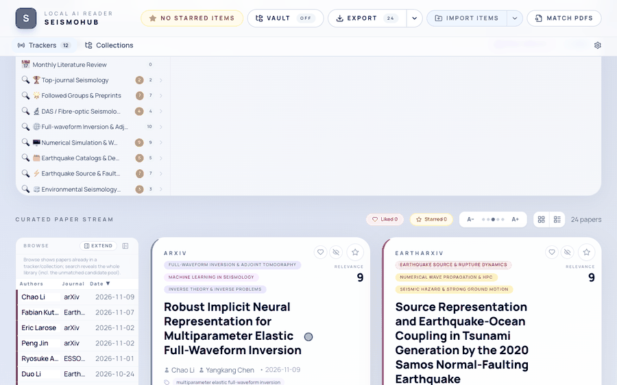
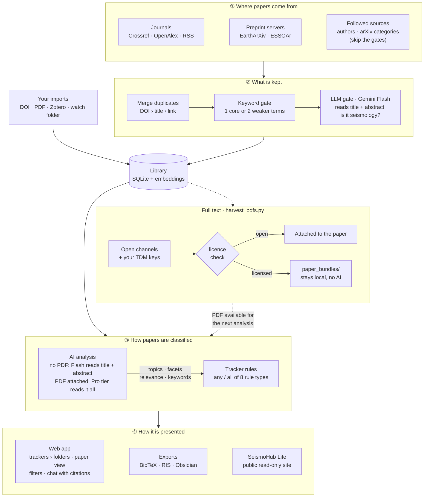
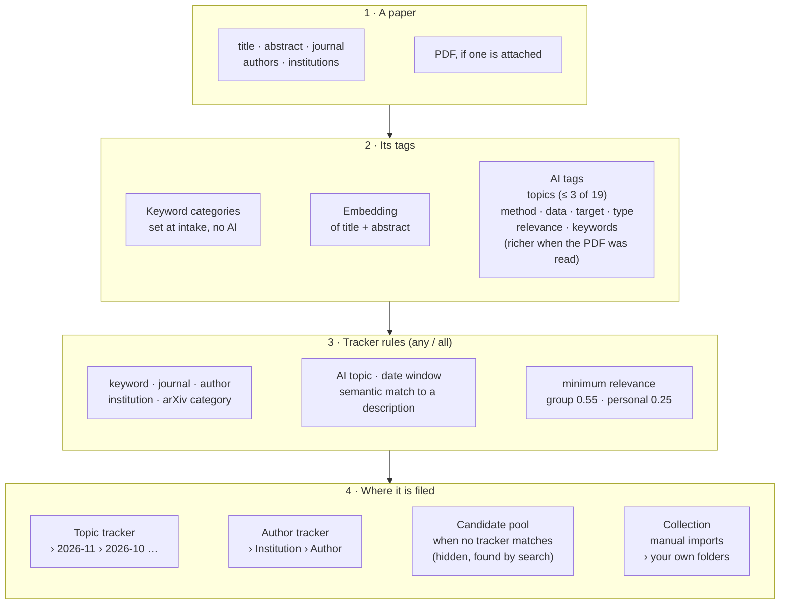
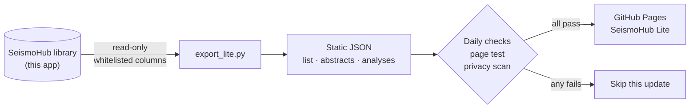
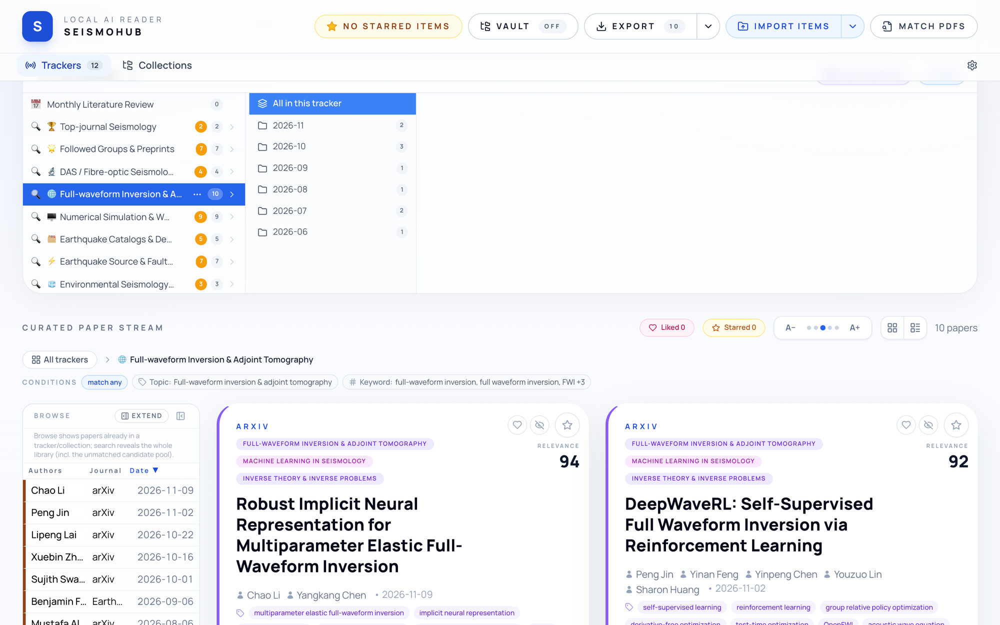
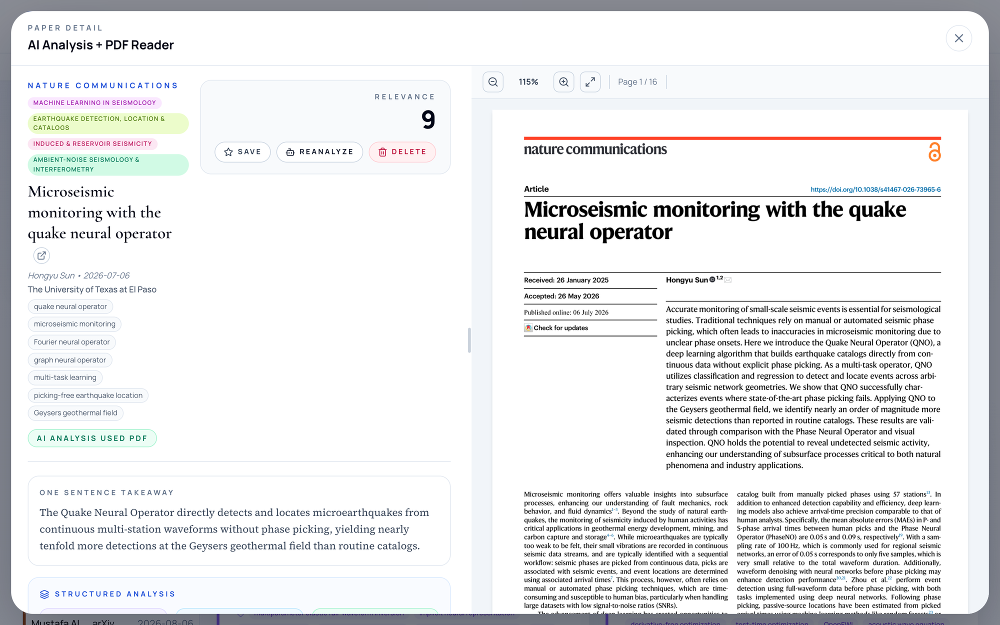
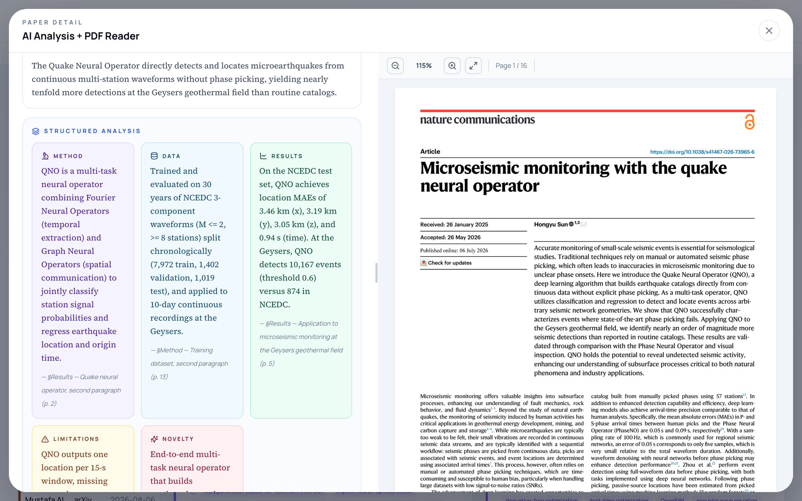

# SeismoHub

**English** · [中文](README_zh.md)

A self-hosted, local-first literature hub for seismology. SeismoHub tracks new papers on the topics, authors and
journals you follow, keeps only the ones that are really about seismology, reads them with Google Gemini, and links
every AI statement to the page and paragraph it came from. It runs on your own machine as one FastAPI process with a
SQLite database. There is no account, no telemetry and no cloud sync; your library is a file you own.



---

## How it works

SeismoHub is a pipeline in four stages around one SQLite library. Whether a paper is kept is decided from its title and
abstract alone. The AI analysis that tags it reads the title and abstract, or the full PDF when one is already
attached. A PDF is never read just to classify a paper, and when one is read, its richer tags are kept. The cheap
steps (fetching, merging duplicates, filtering, embeddings) run on every paper; the AI analysis runs when you open a
paper, or in the background for every new paper if you switch that on.



**① Where papers come from.** Every six hours the server collects the papers of the past 30 days from the journals in
its registry (Crossref and OpenAlex queried by ISSN, plus the publishers' RSS feeds) and from the EarthArXiv and
ESSOAr preprint servers. Trackers add sources of their own: the authors and arXiv categories they follow are fetched
too. You can also add papers by hand: paste a DOI, arXiv ID or URL, upload PDFs, drop files into a watch folder, or
import from Zotero.

**② What is kept.** Records of the same paper from different sources are merged, matched by DOI, then by title,
then by link; a weaker source never overwrites a field that a stronger one has filled. Two gates then keep the library
on topic:

- the **keyword gate** admits a paper whose title and abstract contain one unambiguous seismology term (*earthquake*,
  *seismogram*, *receiver function* ...) or two weaker ones (*fault*, *tomography*, *mantle* ...), and turns away
  look-alikes from medicine and engineering;
- the **LLM gate** asks Gemini Flash, in one cheap call per batch, whether each paper's main subject is seismology.
  It can only remove papers, and on any error it keeps them.

Papers from sources you follow explicitly, and papers you add yourself, skip both gates. Every kept paper gets an
embedding of its title and abstract for semantic matching.

**③ How papers are classified.** Two mechanisms work together:

- **Tracker rules.** A tracker is a set of rules combined with *any* or *all*: keywords, journals, authors,
  institutions, AI topics, semantic similarity to a short description, or a date window. A scheduler re-checks every
  tracker on its own cadence (daily, weekly or monthly) and files matches into monthly folders, or into
  institution / author folders for author trackers. Eleven seismology presets come built in.
- **AI analysis.** Without a PDF, a quick Gemini model (Flash) reads the title, the abstract and public metadata
  (OpenAlex, Crossref, Semantic Scholar, and web search snippets if you configure them). With a PDF attached, a stronger
  model reads the full text. Either way it returns up to three primary topics from a fixed taxonomy of 19 seismology
  topics (with an *off-topic* label for anything else), facets for method, data type, target and paper type, a
  relevance score, keywords, a one-sentence takeaway, a bilingual summary, and structured claims (method, data,
  results, limitations, novelty); claims made from the PDF are anchored to the section, page and paragraph. These tags
  feed the tracker rules. When a paper is analysed again after its PDF arrives (**Reanalyze**, or
  `scripts/reanalyze_stale_pdf.py`), the richer tags from the full text replace the ones from the abstract and the
  paper can join more trackers; tracker assignments are never removed.

**④ How it is presented.** The web app shows your trackers with unread counts, a paper stream with filters and
sorting, and a detail view with the PDF beside the analysis. A chat for each paper answers questions with citations;
clicking one scrolls the PDF to the cited paragraph. The library exports to BibTeX, RIS and CSL-JSON, mirrors to an
Obsidian vault, and can be published read-only as SeismoHub Lite (next section).

**Full text, within the licence.** `scripts/harvest_pdfs.py`, or the bundled agent skill, fetches full texts through
open channels and, if you have them, your institution's text-and-data-mining (TDM) keys. A PDF is accepted only if it
is a real PDF of a sane size, has at least three pages of text, and shows the paper's title or DOI on its first
pages. Its licence tier comes from the copy actually downloaded: open copies are attached to the paper and may be
read by the AI; licensed copies stay in `paper_bundles/` and never reach a hosted AI.

### How a paper is filed



1. **Tags.** At intake a paper gets keyword categories from regular expressions over its title and abstract (no AI)
   and an embedding of its title and abstract. The AI analysis adds the topics, facets, relevance and keywords, and
   replaces the keyword categories with its own topics.
2. **Rules.** Each tracker holds a list of rules joined by *any* or *all*. A scheduler re-checks every tracker on its
   cadence; a new tracker looks back 90 days. Trackers only look at papers that came in automatically; papers you
   import yourself (Zotero, uploads) belong to collections. A minimum relevance keeps weak matches out: 0.55 for
   *group* trackers and 0.25 for *personal* ones, unless you set your own.
3. **Folders.** A topic tracker files its papers by month of publication (`2026-11`, `2026-10`, …). An author tracker
   files them by institution, then author. Collections hold the folders you create. A paper that matches no tracker
   stays in the candidate pool: hidden while you browse, found by search, and filed as soon as a tracker matches it.
4. **What you see.** The Trackers tab lists your trackers with unread counts; open one to see its folders and papers.
   The Collections tab holds your own sets. The Browse table on the left lists every paper in the current view.

### What you can customise

| Setting | Options |
|---|---|
| Tracker rules | keyword · journal · author · institution · AI topic · semantic match to a description (with a threshold) · arXiv category · date window; joined by *any* or *all* |
| Cadence | daily · weekly · monthly |
| Scope and minimum relevance | *group* (0.55) · *personal* (0.25) · or your own value |
| Folders | automatic by month, or by institution › author; your own folders in collections |
| Filters on the paper stream | topic · journal · institution (multi-select) · PDF: has PDF / needs upload · date: last 7 days, last 30 days, all time, custom · liked only · starred only · keyword search |
| Sorting | relevance (similarity to the tracker, then AI relevance) · published date · journal impact factor (highest first; preprints and open platforms last) · author · title · journal · last opened · your own order in collections |
| Starting set | 11 preset seismology trackers under **Add from template**; edit `seed_presets.json` to ship your own |

## SeismoHub and SeismoHub Lite

This repository is the heavy side: on your own machine it fetches, filters, analyses and stores everything, including
PDFs, your notes and your chats. [SeismoHub Lite](https://wangyuhan2002.github.io/seismohub-lite/) is a light,
public window onto one such library: a single static page on GitHub Pages with the paper list, abstracts and AI notes,
updated once a day. Its exporter and checks live in the
[seismohub-lite repository](https://github.com/WANGYuhan2002/seismohub-lite).



How Lite is cut out of the heavy library:

- The exporter opens the database **read-only** and reads only whitelisted columns of the papers and their AI
  analyses.
- It leaves out PDFs and their paths, embeddings, reading state, notes, projects, the chat, verbatim figure captions,
  and papers classified as off-topic.
- Nothing from an analysis made from a PDF is published, so no full text is republished. When a paper is analysed
  again from its PDF, Lite keeps the AI note and tags (topics, keywords, facets, relevance) that it already showed,
  which were made from the abstract. A paper analysed from its PDF before Lite first showed it appears with its
  metadata and abstract only.
- The output is static JSON (the list, the abstracts, and per-paper analyses in shards) plus one HTML file. Search and
  filters run in the reader's browser; the site has no server, no AI and no API key.
- A daily job publishes only when every check passes: a new successful fetch; nothing made from a PDF in the export;
  an unchanged data layout; limits on size and string length, so full text cannot slip in; a headless-browser test of
  the page; and a privacy scan that compares the files against the real key values. If any check fails, that day is
  skipped.

---

## Features

- **Tracking:** trackers by topic, author, journal or institution with daily / weekly / monthly cadence; 11
  seismology presets; semantic matching; unread counts on every tracker.
- **Reading:** bilingual AI analysis, with page-anchored claims once the PDF has been read; the PDF beside the analysis; a chat per paper with
  clickable citations, Markdown and LaTeX.
- **In and out:** add papers from a DOI, arXiv ID, PMID / PMC ID, URL or free text; single or bulk PDF upload matched
  by DOI and title; watch folders; Zotero import; export to BibTeX, RIS, CSL-JSON, a PDF zip and an Obsidian vault.
- **Full text:** a licence-aware harvester with an agent skill; see [docs/PDF_HARVESTING.md](docs/PDF_HARVESTING.md).
- **Other fields:** the seismology lives in a few data files and prompts; see
  [docs/ADAPTING_TO_OTHER_FIELDS.md](docs/ADAPTING_TO_OTHER_FIELDS.md).

## Screenshots

**Trackers and the paper stream.** The 11 preset trackers, each with its own rules and monthly folders.



**AI analysis next to the PDF.** Topics, keywords and a one-sentence takeaway, with the paper open alongside.



**Structured analysis with page references.** Method, data, results, limitations and novelty, each pointing to the
section and page it came from.



The screenshots show a demo library of open-access papers (arXiv, EarthArXiv, CC BY journal articles).

---

## Get started

> SeismoHub is single-user software and has **no login**. Run it on `127.0.0.1` (the default) or behind a reverse
> proxy that handles authentication. See [Security](#security-and-licensed-content).

If you set things up with an AI coding agent, point it at this README and [`.env.example`](.env.example); the steps
below are what it should run.

Requirements: Python **3.11 or newer**, and a Google Vertex AI API key for the AI features.

```bash
git clone https://github.com/WANGYuhan2002/seismohub.git
cd seismohub
python3.11 -m venv .venv
source .venv/bin/activate            # Windows: .venv\Scripts\activate
pip install -r requirements.txt
cp .env.example .env                 # then set VERTEX_AI_API_KEY, VERTEX_AI_PROJECT, PIPELINE_CONTACT_EMAIL
SEISMO_PORT=8000 python main.py
```

Open <http://127.0.0.1:8000>. On the first start SeismoHub creates `seismo_hub.db`, seeds the preset trackers and
starts fetching recent papers in the background. To start with an empty, offline instance instead:

```bash
SEISMO_NO_AUTOFETCH=1 SEISMO_NO_PRESET_SEED=1 SEISMO_PORT=8000 python main.py
```

You can also enter the keys later on the in-app **Settings** page. It writes them to `.env` with file mode 0600.

### Docker

```bash
cp .env.example .env                 # add your keys
mkdir -p data downloads paper_bundles
docker compose up -d --build
```

The app is then at <http://localhost:8000>, published on the host's `127.0.0.1` only. The database, PDFs and full-text
bundles stay on the host in `./data`, `./downloads` and `./paper_bundles`. More options, including remote servers and
backups, are in [docs/DEPLOYMENT.md](docs/DEPLOYMENT.md).

---

## Configuration

All settings are environment variables, documented in [`.env.example`](.env.example). The main ones:

| Variable | Needed for | Where to get it |
|---|---|---|
| `VERTEX_AI_API_KEY` | AI analysis (required); chat and embeddings | Google Cloud console → Vertex AI → API keys |
| `VERTEX_AI_PROJECT` | Models that are routed through your project | Your Google Cloud project ID |
| `GEMINI_API_KEY` | Fallback for chat and embeddings only | Google AI Studio |
| `PIPELINE_CONTACT_EMAIL` | Polite-pool access to OpenAlex / Crossref / Unpaywall | Your own e-mail address |
| `GOOGLE_CUSTOM_SEARCH_API_KEY`, `GOOGLE_CSE_CX` | Optional web context in the AI analysis | Google Programmable Search |
| `ETH_RC_API_KEY` | Optional ETH Research Collection source | ETH Library API portal |
| `ELSEVIER_API_KEY`, `WILEY_TDM_TOKEN`, `OPENALEX_API_KEY` | Optional full-text harvesting channels | Publisher developer portals |

**API cost.** The server can analyse every new paper in the background as soon as it arrives. `.env.example` turns
this off (`DISABLE_EAGER_ANALYSIS=1`), so papers are analysed when you open them. Remove that line to analyse
everything ahead of time.

---

## Full-text PDF harvesting

```bash
python scripts/harvest_pdfs.py --dry-run --limit 20     # check what would be fetched; writes nothing
python scripts/harvest_pdfs.py --limit 100              # fetch, verify and attach open copies
python scripts/harvest_literature_list.py --input-file reading_list.txt --out-dir ~/seismo_pack
```

- `harvest_pdfs.py` fills in missing PDFs for papers already in your library. It backs up the database before it
  writes anything.
- `harvest_literature_list.py` fetches any list of DOIs, arXiv IDs or citations into a folder, without touching the
  database.
- Papers that publishers block for scripts are written to a checklist. Download those in your browser, then use
  **Upload missing PDFs** in the app.
- Harvesting never starts an AI analysis. `scripts/reanalyze_stale_pdf.py` redoes the analyses that were written
  before a paper's PDF arrived; it previews and estimates the cost unless you pass `--run`.

Channels, keys, licence tiers and reports are described in [docs/PDF_HARVESTING.md](docs/PDF_HARVESTING.md).

The harvester also runs on its own, without SeismoHub:
[paper-pdf-harvest](https://github.com/WANGYuhan2002/paper-pdf-harvest) uses the same engine for any reading list
(DOIs, arXiv IDs, citations, `.bib` exports), sorts browser and Zotero downloads by licence, and documents which keys
to register, the measured coverage and the limits.

### Agent skill

The repository ships a [Claude Code](https://claude.com/claude-code) skill at
[`.claude/skills/seismohub-pdf-harvest/`](.claude/skills/seismohub-pdf-harvest/SKILL.md). Open the repository in
Claude Code and ask, for example, *"fetch the missing PDFs for my GJI papers"* or *"download full texts for this DOI
list"*. The skill runs a dry run first, applies the licence rules, and summarises the run report with
`harvest_status.py`. Other coding agents can follow the same `SKILL.md`.

---

## Security and licensed content

- **No authentication.** `python main.py` listens on `127.0.0.1`. For remote use, connect through an SSH tunnel or a
  reverse proxy with authentication. Do not expose the port to the internet: anyone who can reach it can read your
  library and change your API keys.
- **Keys** live in `.env` (git-ignored, mode 0600) or in `~/.config/seismo_harvester/keys.env` outside the
  repository. The Settings page only ever shows masked values.
- **What is sent to Google.** The AI analysis uploads the attached PDF to Gemini. The chat sends cached page text.
  Embeddings send titles and abstracts. Nothing else leaves your machine except metadata queries to the scholarly
  APIs listed above.
- **Licensed full text stays local.** Copies obtained through institutional TDM licences, and PDFs that carry "All
  rights reserved" or an institutional download stamp without an open licence, are kept in `paper_bundles/`, never
  attached to the app and never sent to hosted AI. The chat refuses for such papers.
- **Publisher terms.** The harvester sends an honest User-Agent, waits between requests to each host, and skips sites
  that answer scripts with a bot challenge. It never solves CAPTCHAs or works around Cloudflare. Use TDM keys only
  within the terms your institution signed.

Report security issues as described in [SECURITY.md](SECURITY.md).

---

## Documentation

| Guide | English | 中文 |
|---|---|---|
| Deployment, backups, troubleshooting | [DEPLOYMENT.md](docs/DEPLOYMENT.md) | [DEPLOYMENT_zh.md](docs/DEPLOYMENT_zh.md) |
| Full-text PDF harvesting | [PDF_HARVESTING.md](docs/PDF_HARVESTING.md) | [PDF_HARVESTING_zh.md](docs/PDF_HARVESTING_zh.md) |
| Adapting SeismoHub to another field | [ADAPTING_TO_OTHER_FIELDS.md](docs/ADAPTING_TO_OTHER_FIELDS.md) | [ADAPTING_TO_OTHER_FIELDS_zh.md](docs/ADAPTING_TO_OTHER_FIELDS_zh.md) |
| Agent skill for PDF harvesting | [SKILL.md](.claude/skills/seismohub-pdf-harvest/SKILL.md) | |
| Standalone PDF harvester (same engine, no SeismoHub needed) | [paper-pdf-harvest](https://github.com/WANGYuhan2002/paper-pdf-harvest) | [README_zh.md](https://github.com/WANGYuhan2002/paper-pdf-harvest/blob/main/README_zh.md) |

## Project layout

```
main.py                 FastAPI app (85 routes) and background schedulers
db.py, models.py        SQLite schema, idempotent migrations, SQLAlchemy 1.4 models
services/               fetching, AI analysis, chat, embeddings, citation anchors, exports, Obsidian vault,
                        Zotero import, PDF matching, full-text harvester, licence guards
templates/index.html    the whole web UI (vanilla JS + Tailwind)
scripts/                harvesting and maintenance command-line tools
seed_presets.json       the 11 preset trackers
tests/                  pytest suite (offline; in-memory database)
docs/                   guides in English and Chinese, screenshots
.claude/skills/         agent skill for PDF harvesting
```

## Development

```bash
pip install -r requirements.txt
DISABLE_TRACKER_SCHEDULER=1 DISABLE_EAGER_ANALYSIS=1 SEISMO_NO_AUTOFETCH=1 python -m pytest -q
```

The tests run offline against an in-memory database and need no API keys. See [CONTRIBUTING.md](CONTRIBUTING.md).

## License

[MIT](LICENSE). Paper metadata comes from OpenAlex (CC0), Crossref, arXiv and the publishers' own feeds. Full texts
remain under their publishers' licences.
