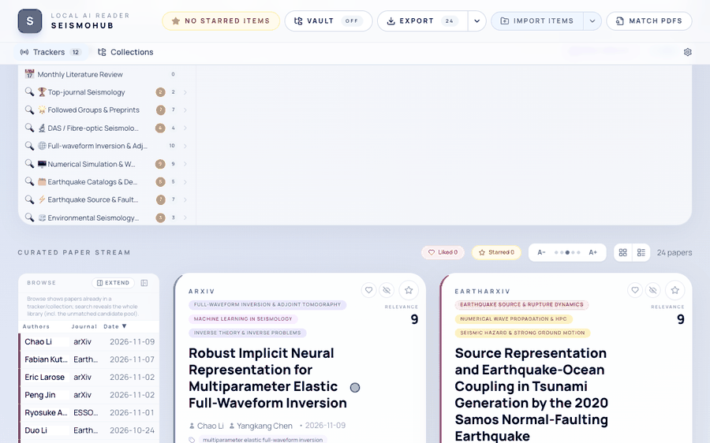
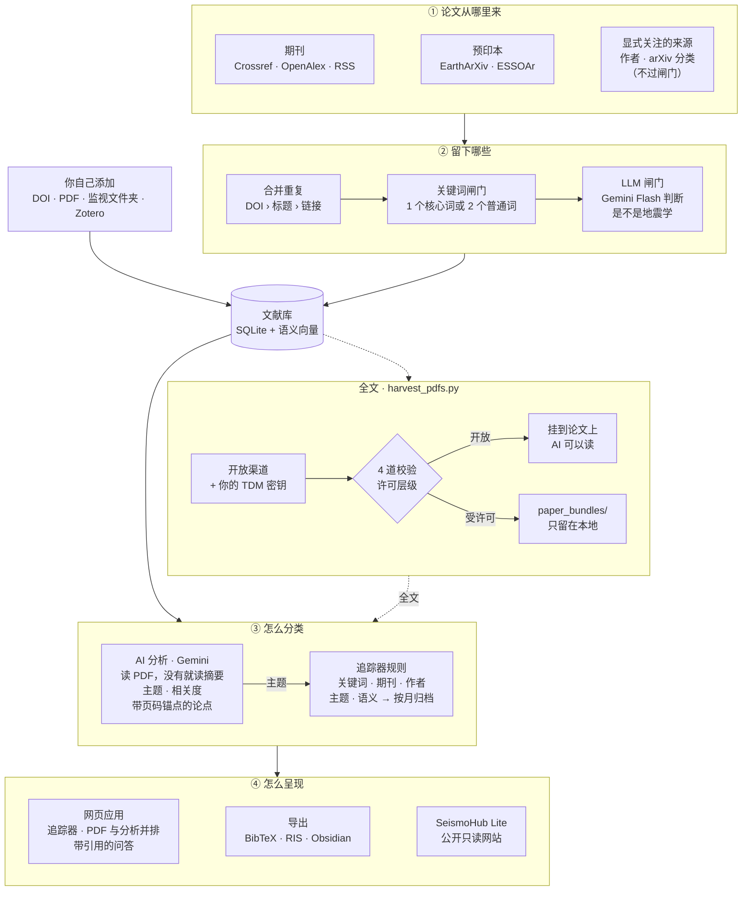
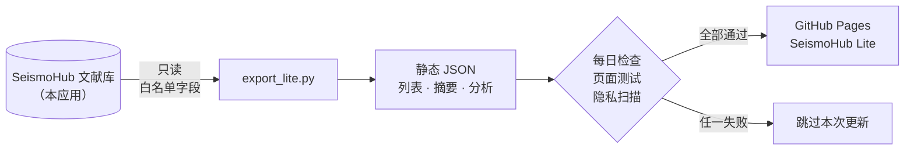
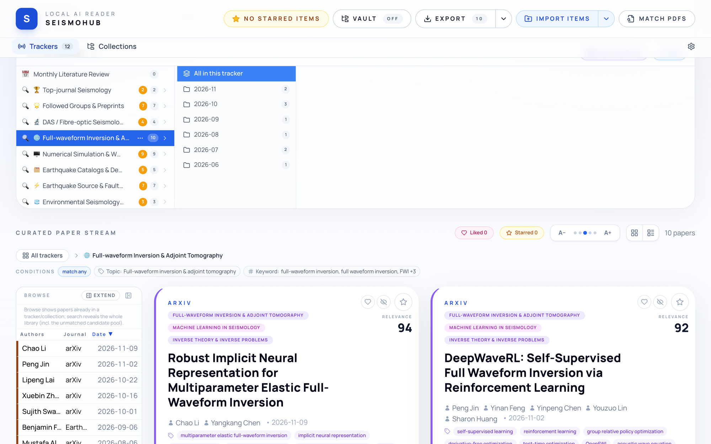
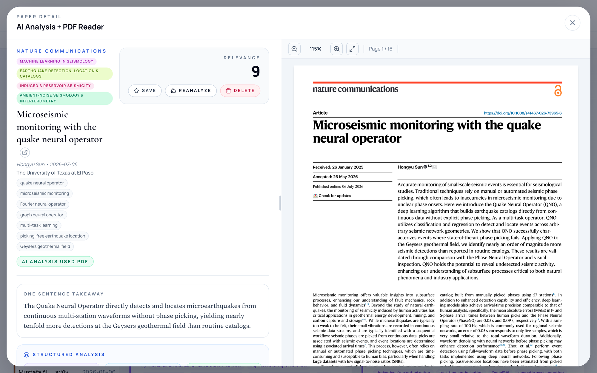
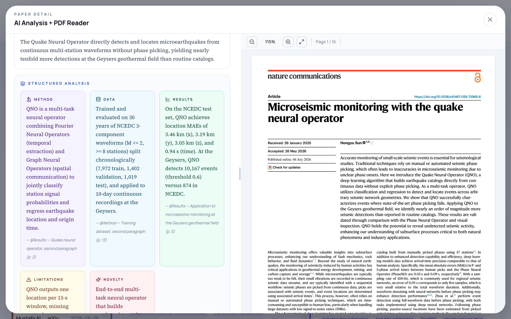

# SeismoHub

[English](README.md) · **中文**

面向地震学研究者的自托管、本地优先的文献中心。SeismoHub 按你关注的主题、作者和期刊追踪新论文，只留下真正属于地震学的那些，
用 Google Gemini 精读，并把每一条 AI 结论都链接回原文的页码和段落。它在你自己的电脑上以一个 FastAPI 进程加一个 SQLite
数据库运行：没有账号，没有遥测，没有云同步，文献库就是你自己的一个文件。



---

## 工作原理

SeismoHub 是围绕一个 SQLite 文献库的四段式流水线。便宜的步骤（抓取、合并重复、过滤、计算向量）对每篇论文都执行；
昂贵的那一步，即用 Gemini 精读论文，在你打开这篇论文时才执行；如果你打开了后台分析，则对每篇新论文都执行。



**① 论文从哪里来。** 服务每 6 小时收集一次过去 30 天的论文，来源是期刊清单里的期刊（按 ISSN 查询 Crossref 和 OpenAlex，
加上出版社的 RSS），以及 EarthArXiv 和 ESSOAr 两个预印本服务器。追踪器还会带来自己的来源：它们关注的作者和 arXiv 分类
也会被抓取。你也可以手动添加：粘贴 DOI、arXiv ID 或网址，上传 PDF，把文件放进监视文件夹，或从 Zotero 导入。

**② 留下哪些。** 同一篇论文从不同来源来的记录会被合并，先按 DOI 匹配，再按标题，再按链接；弱来源不会覆盖强来源已经填好的
字段。之后有两道闸门保证文献库不跑题：

- **关键词闸门**：标题和摘要里出现一个无歧义的地震学核心词（*earthquake*、*seismogram*、*receiver function* ……），
  或两个较弱的词（*fault*、*tomography*、*mantle* ……）才放行，并挡掉医学、工程领域里用词相似的论文；
- **LLM 闸门**：每批论文调用一次便宜的 Gemini Flash，问它每篇论文的主题是不是地震学。它只能删论文，出任何错都保留。

来自你显式关注的来源的论文，以及你自己添加的论文，两道闸门都不经过。每篇留下的论文都会计算标题加摘要的向量，用于语义匹配。

**③ 怎么分类。** 两套机制配合工作：

- **追踪器规则。** 一个追踪器就是一组用 *any*（任一）或 *all*（全部）组合的规则：关键词、期刊、作者、机构、AI 主题、
  与一段描述的语义相似度、日期窗口。调度器按每个追踪器自己的周期（每天、每周、每月）重新检查，把匹配到的论文按月归档；
  作者追踪器则按机构 / 作者归档。内置 11 个地震学预置追踪器。
- **AI 分析。** 有 PDF 时 Gemini 读全文，没有时读摘要加网络元数据。它给出：从固定的 19 类地震学主题中选出的至多 3 个
  主主题（其他内容标为"非地震学"）；方法、数据类型、研究对象和文章类型等分面；相关度分数；一句话要点；中英双语总结；
  以及结构化论点（方法、数据、结果、局限、创新点），每条都锚定到来源的章节、页码和段落。这些主题会反过来供追踪器规则使用。

**④ 怎么呈现。** 网页应用显示带未读数的追踪器、可筛选排序的论文流，以及 PDF 与分析并排的详情页。每篇论文都有一个问答对话，
回答带引用，点击引用 PDF 就会滚到被引用的段落。文献库可以导出为 BibTeX、RIS 和 CSL-JSON，同步到 Obsidian 笔记库，
也可以只读地发布成 SeismoHub Lite（见下一节）。

**全文，在许可范围内。** `scripts/harvest_pdfs.py`（或附带的 Agent 技能）通过开放渠道，以及你所在机构的文本与数据挖掘
（TDM）密钥（如果有）抓取全文。PDF 必须确实是 PDF、大小正常、至少有 3 页文字，并且前几页能找到这篇论文的标题或 DOI，
才会被接受。许可层级按实际下载到的那一份判定：开放副本挂到论文上，AI 可以读；受许可的副本留在 `paper_bundles/`，
永远不会发给云端 AI。

## SeismoHub 与 SeismoHub Lite

本仓库是"重"的一端：在你自己的电脑上抓取、过滤、分析并保存一切，包括 PDF、你的笔记和问答记录。
[SeismoHub Lite](https://wangyuhan2002.github.io/seismohub-lite/) 是"轻"的一端：一个公开的、只读的窗口，
展示某个文献库的论文列表、摘要和 AI 笔记，是 GitHub Pages 上的一个静态网页，每天更新一次。它的导出脚本和检查工具在
[seismohub-lite 仓库](https://github.com/WANGYuhan2002/seismohub-lite)里。



Lite 是这样从重型文献库里抽取出来的：

- 导出脚本以**只读**方式打开数据库，只读取论文和 AI 分析中白名单里的字段。
- 不导出：PDF 及其路径、向量、阅读状态、笔记、项目、问答记录、图注原文，以及被分类为"非地震学"的论文。
- 只发布基于摘要和元数据生成的分析，不发布基于 PDF 生成的分析，所以不会转载任何全文。
- 输出是静态 JSON（列表、摘要、按分片存放的单篇分析）加一个 HTML 文件。搜索和筛选在读者的浏览器里完成；网站本身没有
  服务器、没有 AI，也没有 API 密钥。
- 每日任务只有在所有检查都通过时才发布：有一次新的成功抓取、数据结构没变、体积和字符串长度都在上限内（防止全文混进去）、
  无界面浏览器里的页面测试通过、隐私扫描逐字比对真实密钥值后没有发现问题。任何一项不通过，当天就跳过。

---

## 功能

- **追踪：** 按主题、作者、期刊或机构建立追踪器，每天 / 每周 / 每月更新；11 个地震学预置；语义匹配；未读计数和"上次访问以来的新论文"。
- **阅读：** 双语 AI 分析，论点带页码锚点；PDF 与分析并排；每篇论文都有问答，引用可点击，支持 Markdown 和 LaTeX。
- **导入导出：** 用 DOI、arXiv ID、PMID / PMC ID、网址或任意文字添加论文；单篇或批量上传 PDF，按 DOI 和标题自动匹配；
  监视文件夹；Zotero 导入；导出 BibTeX、RIS、CSL-JSON、PDF 压缩包和 Obsidian 笔记库。
- **全文：** 遵守许可的全文抓取器和配套 Agent 技能，见 [docs/PDF_HARVESTING_zh.md](docs/PDF_HARVESTING_zh.md)。
- **其他学科：** 地震学相关的内容只在几个数据文件和提示词里，见 [docs/ADAPTING_TO_OTHER_FIELDS_zh.md](docs/ADAPTING_TO_OTHER_FIELDS_zh.md)。

## 截图

**追踪器与论文流。** 11 个预置追踪器，各有自己的规则和按月归档的文件夹。



**AI 分析与 PDF 并排。** 主题、关键词和一句话要点，旁边就是论文原文。



**带页码出处的结构化分析。** 方法、数据、结果、局限和创新点，每一条都标明来自哪一节、哪一页。



截图使用的是一个由开放获取论文（arXiv、EarthArXiv、CC BY 期刊文章）组成的演示库。

---

## 开始使用

> SeismoHub 是单用户软件，**没有登录功能**。请让它只监听 `127.0.0.1`（默认就是这样），或放在带认证的反向代理后面。
> 详见[安全与受许可内容](#安全与受许可内容)。

如果你用 AI 编程助手来安装，把这份 README 和 [`.env.example`](.env.example) 交给它即可；下面就是它应该执行的步骤。

需要 **Python 3.11 或更新版本**，AI 功能需要一个 Google Vertex AI API 密钥。

```bash
git clone https://github.com/WANGYuhan2002/seismohub.git
cd seismohub
python3.11 -m venv .venv
source .venv/bin/activate            # Windows：.venv\Scripts\activate
pip install -r requirements.txt
cp .env.example .env                 # 然后填写 VERTEX_AI_API_KEY、VERTEX_AI_PROJECT、PIPELINE_CONTACT_EMAIL
SEISMO_PORT=8000 python main.py
```

浏览器打开 <http://127.0.0.1:8000>。首次启动会创建 `seismo_hub.db`、写入预置追踪器，并在后台开始抓取近期论文。
如果想要一个空的、不联网抓取的实例：

```bash
SEISMO_NO_AUTOFETCH=1 SEISMO_NO_PRESET_SEED=1 SEISMO_PORT=8000 python main.py
```

密钥也可以稍后在应用内的 **Settings（设置）** 页面填写，它会以 0600 权限写入 `.env`。

### Docker

```bash
cp .env.example .env                 # 填入密钥
mkdir -p data downloads paper_bundles
docker compose up -d --build
```

然后访问 <http://localhost:8000>。端口只发布在宿主机的 `127.0.0.1` 上。数据库、PDF 和全文包都保存在宿主机的
`./data`、`./downloads` 和 `./paper_bundles`。远程服务器、备份等更多部署方式见 [docs/DEPLOYMENT_zh.md](docs/DEPLOYMENT_zh.md)。

---

## 配置

所有设置都是环境变量，完整说明见 [`.env.example`](.env.example)。主要的几项：

| 变量 | 用途 | 获取方式 |
|---|---|---|
| `VERTEX_AI_API_KEY` | AI 分析（必需）；问答和语义向量 | Google Cloud 控制台 → Vertex AI → API 密钥 |
| `VERTEX_AI_PROJECT` | 经你的项目路由的模型 | 你的 Google Cloud 项目 ID |
| `GEMINI_API_KEY` | 仅作问答和语义向量的回退 | Google AI Studio |
| `PIPELINE_CONTACT_EMAIL` | 进入 OpenAlex / Crossref / Unpaywall 的礼貌池 | 你自己的邮箱 |
| `GOOGLE_CUSTOM_SEARCH_API_KEY`、`GOOGLE_CSE_CX` | 可选：AI 分析时补充网络检索结果 | Google 可编程搜索 |
| `ETH_RC_API_KEY` | 可选：ETH Research Collection 来源 | ETH 图书馆 API 门户 |
| `ELSEVIER_API_KEY`、`WILEY_TDM_TOKEN`、`OPENALEX_API_KEY` | 可选：全文抓取渠道 | 各出版商的开发者门户 |

**API 费用。** 服务可以在每篇新论文到达时就在后台分析它。`.env.example` 默认关闭了这一功能（`DISABLE_EAGER_ANALYSIS=1`），
论文会在你打开时再分析。删掉这一行即可恢复后台全量分析。

---

## 全文 PDF 抓取

```bash
python scripts/harvest_pdfs.py --dry-run --limit 20     # 先看会抓到什么，不写入任何东西
python scripts/harvest_pdfs.py --limit 100              # 抓取、校验，并把开放副本挂到论文上
python scripts/harvest_literature_list.py --input-file reading_list.txt --out-dir ~/seismo_pack
```

- `harvest_pdfs.py` 为库里已有的论文补齐 PDF。写入前会自动备份数据库。
- `harvest_literature_list.py` 把任意一份 DOI、arXiv ID 或引文清单抓到一个文件夹里，不碰数据库。
- 出版商不允许脚本下载的论文会写进一份清单。用浏览器下载它们，再用应用里的 **Upload missing PDFs（上传缺失的 PDF）**。
- 抓取从不触发 AI 分析。`scripts/reanalyze_stale_pdf.py` 会重做那些"写于 PDF 挂上之前"的分析；不加 `--run` 时只预览并估算费用。

渠道、密钥、许可层级和运行报告的说明见 [docs/PDF_HARVESTING_zh.md](docs/PDF_HARVESTING_zh.md)。

### Agent 技能

仓库自带一个 [Claude Code](https://claude.com/claude-code) 技能：
[`.claude/skills/seismohub-pdf-harvest/`](.claude/skills/seismohub-pdf-harvest/SKILL.md)。用 Claude Code 打开仓库，
直接说"帮我把 GJI 论文缺的 PDF 抓下来"或"下载这份 DOI 清单的全文"即可。技能会先试运行，遵守许可规则，
并用 `harvest_status.py` 汇总运行报告。其他编程 Agent 也可以照着同一份 `SKILL.md` 执行。

---

## 安全与受许可内容

- **没有认证。** `python main.py` 只监听 `127.0.0.1`。远程使用请通过 SSH 隧道或带认证的反向代理。不要把端口暴露到公网：
  任何能访问它的人都能读取你的文献库、修改你的 API 密钥。
- **密钥**保存在 `.env`（已被 git 忽略，权限 0600），或仓库外的 `~/.config/seismo_harvester/keys.env`。设置页面只显示打码后的值。
- **哪些内容会发给 Google。** AI 分析会把挂载的 PDF 上传给 Gemini；问答发送缓存的页面文字；语义向量发送标题和摘要。
  除此之外，只有对上述学术 API 的元数据查询会离开你的电脑。
- **受许可的全文只留在本地。** 通过机构 TDM 许可取得的副本，以及首页写有 "All rights reserved" 或带机构下载水印、
  却没有开放许可声明的 PDF，都只保存在 `paper_bundles/`：不挂进应用，不发给云端 AI。这类论文的问答会直接拒绝。
- **出版商条款。** 抓取器使用如实的 User-Agent，对每个站点的请求都有间隔，遇到对脚本返回人机验证的站点就跳过。
  它不会破解验证码，也不会绕过 Cloudflare。TDM 密钥请只在你所在机构签署的条款范围内使用。

安全问题的报告方式见 [SECURITY.md](SECURITY.md)。

---

## 文档

| 指南 | 中文 | English |
|---|---|---|
| 部署、备份、常见问题 | [DEPLOYMENT_zh.md](docs/DEPLOYMENT_zh.md) | [DEPLOYMENT.md](docs/DEPLOYMENT.md) |
| 全文 PDF 抓取 | [PDF_HARVESTING_zh.md](docs/PDF_HARVESTING_zh.md) | [PDF_HARVESTING.md](docs/PDF_HARVESTING.md) |
| 把 SeismoHub 迁移到其他学科 | [ADAPTING_TO_OTHER_FIELDS_zh.md](docs/ADAPTING_TO_OTHER_FIELDS_zh.md) | [ADAPTING_TO_OTHER_FIELDS.md](docs/ADAPTING_TO_OTHER_FIELDS.md) |
| PDF 抓取的 Agent 技能 | [SKILL.md](.claude/skills/seismohub-pdf-harvest/SKILL.md) | |

## 目录结构

```
main.py                 FastAPI 应用（85 个路由）和后台调度
db.py, models.py        SQLite 表结构、幂等迁移、SQLAlchemy 1.4 模型
services/               抓取、AI 分析、问答、向量、引用锚点、导出、Obsidian 笔记库、
                        Zotero 导入、PDF 匹配、全文抓取器、许可守卫
templates/index.html    整个网页界面（原生 JS + Tailwind）
scripts/                抓取与维护用的命令行工具
seed_presets.json       11 个预置追踪器
tests/                  pytest 测试（离线运行，使用内存数据库）
docs/                   中英文指南、截图
.claude/skills/         PDF 抓取的 Agent 技能
```

## 开发

```bash
pip install -r requirements.txt
DISABLE_TRACKER_SCHEDULER=1 DISABLE_EAGER_ANALYSIS=1 SEISMO_NO_AUTOFETCH=1 python -m pytest -q
```

测试离线运行，使用内存数据库，不需要任何 API 密钥。参见 [CONTRIBUTING.md](CONTRIBUTING.md)。

## 许可证

[MIT](LICENSE)。论文元数据来自 OpenAlex（CC0）、Crossref、arXiv 和出版商自己的订阅源；全文的版权仍归各出版商所有。
